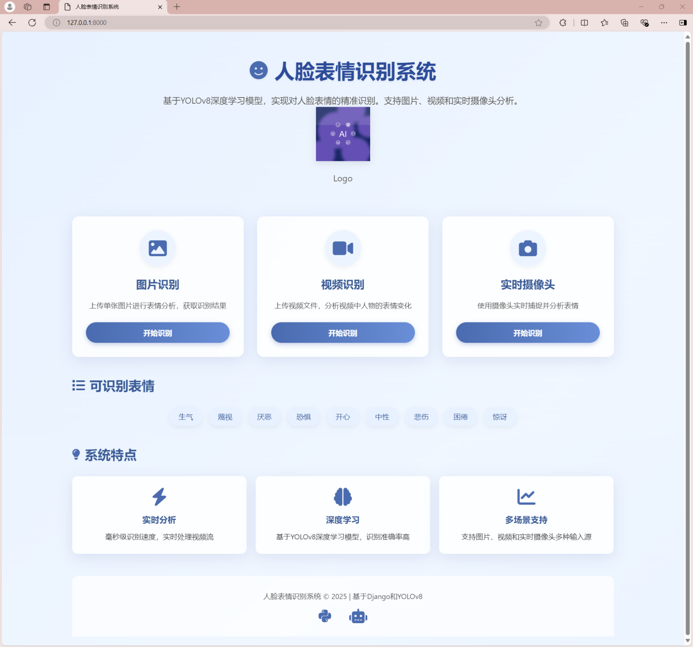
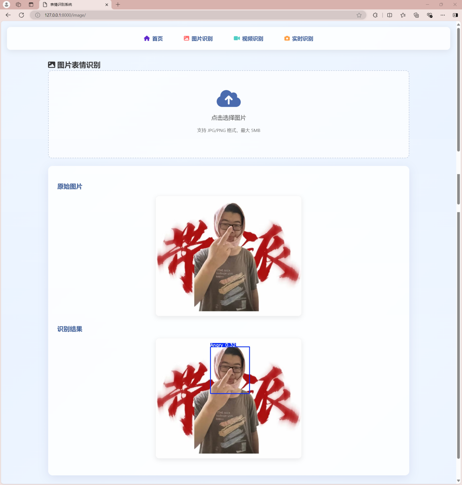
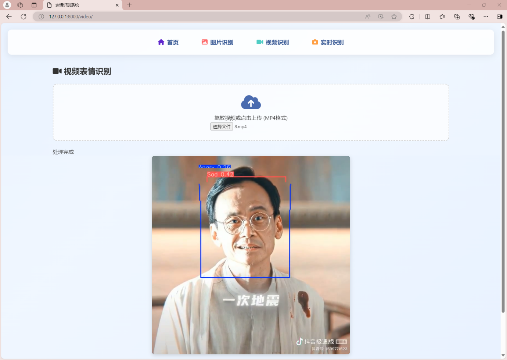
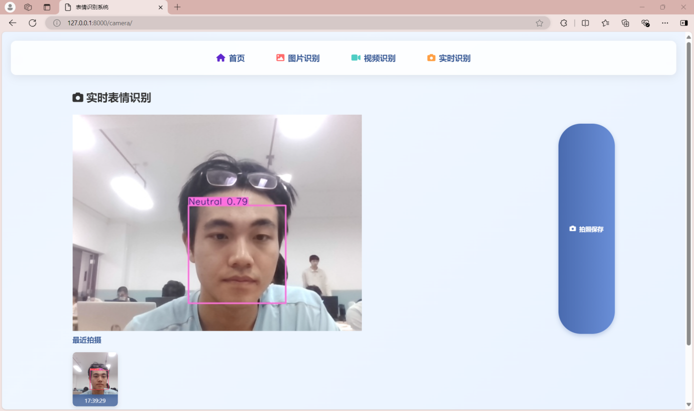

# Facial Expression Recognition System

[简体中文](README.md) | [English](README.en.md)

A **Django + YOLOv8** application for detecting nine facial expression classes in uploaded images, videos, and a live camera stream.


> The original project reports describe a Django and YOLOv8m system. The bundled `weights/best.pt` uses a **YOLOv8n-sized** model (approximately 3 million parameters, 6 MB). To train a YOLOv8m variant, replace `yolov8n.pt` with `yolov8m.pt` in `training/yolo/train.py` and retrain.

## Features

| Feature | Description |
| --- | --- |
| Image recognition | Upload JPG/PNG images and receive annotations with classes and confidence scores |
| Video recognition | Process uploaded MP4 videos frame by frame; FFmpeg is required |
| Live camera | Django reads its host computer's camera and serves an MJPEG stream, with snapshot support |
| Nine expressions | Angry, Contempt, Disgust, Fear, Happy, Neutral, Sad, Sleepy, Surprised |
| Web interface | Django Templates and plain JavaScript; no separate frontend build |

## Preview

| Home | Image recognition |
| :---: | :---: |
|  |  |

| Video recognition | Live camera |
| :---: | :---: |
|  |  |

## Stack

- **Backend:** Python 3.10+, Django 5.1.
- **Detection:** Ultralytics YOLOv8 for nine expression classes.
- **Classification experiments:** ResNet34, AlexNet, and VGG16 with PyTorch.
- **Image processing:** OpenCV, NumPy, Pillow.
- **Frontend:** HTML5, CSS3, JavaScript.
- **Development database:** SQLite.

## Structure

```text
Facial-Recognize-System/
├── web/                          # Django application
│   ├── emotion_detection/        # Settings, URLs, WSGI
│   ├── detection_app/            # Views, routes, model loading
│   ├── templates/                # Home, image, video, camera pages
│   ├── static/                   # CSS, JavaScript, logo
│   ├── media/                    # Runtime uploads and results
│   ├── manage.py
│   └── requirements.txt
├── training/
│   ├── dataset/                  # YOLO dataset and data.yaml
│   ├── yolo/                     # Training, inference, evaluation, camera
│   ├── classifiers/              # ResNet34, AlexNet, VGG16
│   ├── augmentation/             # Data augmentation
│   ├── tools/                    # Dataset and GPU utilities
│   └── requirements.txt
├── weights/best.pt               # Bundled YOLOv8 detection weights
├── scripts/                      # Demonstrations and utilities
├── docs/                         # Reports, presentation, screenshots
├── README.md
├── README.en.md
├── LICENSE
└── .gitignore
```

## Getting started

### 1. Requirements

- Python **3.10+**; the original setup notes report testing on Python 3.12.
- **FFmpeg** on `PATH` for video processing.
- A camera connected to the computer running Django for live streaming. The current backend uses Windows `CAP_DSHOW`; the browser page also requests camera permission.

### 2. Install dependencies

```bash
git clone https://github.com/Incredible-Jian/Facial-Recognize-System.git
cd Facial-Recognize-System
python -m venv .venv
```

Activate the virtual environment in PowerShell:

```powershell
.\.venv\Scripts\Activate.ps1
```

Or on macOS / Linux:

```bash
source .venv/bin/activate
```

Then install dependencies:

```bash
python -m pip install -r web/requirements.txt
```

### 3. Start Django

```bash
cd web
python manage.py migrate
python manage.py runserver
```

Open <http://127.0.0.1:8000>. The untracked `web/db.sqlite3` is created by migrations on first setup.

For deployment, set a persistent `DJANGO_SECRET_KEY`, `DJANGO_DEBUG=0`, and appropriate `DJANGO_ALLOWED_HOSTS`. Development mode generates a temporary secret when none is configured, which invalidates admin sessions after a restart. With `DJANGO_DEBUG=0`, an empty or missing secret prevents startup.

See [.env.example](.env.example) for supported variables. Django does not automatically load this file; export variables in the terminal that starts the process, for example `$env:DJANGO_DEBUG = "1"` in PowerShell.

### 4. Model weights

| File | Size | Purpose | Availability |
| --- | ---: | --- | --- |
| `weights/best.pt` | 6 MB | YOLOv8 detection used by the web application | Included |
| `weights/resNet34.pth` | 82 MB | Legacy five-class ResNet34; incompatible with nine classes, retraining recommended | See [Releases](https://github.com/Incredible-Jian/Facial-Recognize-System/releases) |
| `weights/AlexNet_9classes.pth` | 56 MB | AlexNet expression classification | See [Releases](https://github.com/Incredible-Jian/Facial-Recognize-System/releases) |
| `weights/vgg16Net.pth` | — | VGG16 classification | Generate with the training script |

Place downloaded `.pth` files in `weights/`.

## Training and evaluation

```bash
python -m pip install -r training/requirements.txt
```

### Dataset

The dataset uses YOLO layout with relative paths in `training/dataset/data.yaml`:

```text
dataset/
├── data.yaml
├── train/{images,labels}
├── valid/{images,labels}
└── test/{images,labels}
```

The repository includes 100 sample images per split for checking the workflow. Project reports describe a full experiment using RAF-DB and additional collected data, approximately 12,000 images. Keep this layout when supplying your own data.

### YOLOv8 detection

```bash
python training/yolo/train.py
python training/yolo/eval.py
python training/yolo/predict.py
python training/yolo/video.py    # Press q to exit
```

### Classification models

```bash
# ResNet34
python training/classifiers/resnet/train.py
python training/classifiers/resnet/predict.py
python training/classifiers/resnet/eval.py

# AlexNet
python training/classifiers/alexnet/train.py
python training/classifiers/alexnet/predict.py
python training/classifiers/alexnet/eval.py

# VGG16
python training/classifiers/vgg/train.py
python training/classifiers/vgg/predict.py
python training/classifiers/vgg/eval.py
```

Training scripts resolve dataset paths within the repository and save output weights in the corresponding model directories. Evaluation scripts produce artifacts such as confusion matrices, ROC curves, and classification reports.

## Routes

| Method | Path | Purpose |
| --- | --- | --- |
| GET | `/` | Home |
| GET | `/image/` | Image recognition page |
| POST | `/process_image/` | Annotate an uploaded image; multipart field `image` |
| GET | `/video/` | Video recognition page |
| POST | `/process_video/` | Annotate an uploaded video; multipart field `video` |
| GET | `/camera/` | Live camera page |
| GET | `/video_feed/` | MJPEG stream |
| POST | `/capture/` | Capture the current frame |
| POST | `/stop_camera/` | Stop the camera |
| GET | `/admin/` | Django admin |

## Reported experimental results

These figures come from the project documentation. They were not independently reproduced during repository cleanup and should not be treated as benchmarks of the bundled checkpoint or every hardware configuration.

| Metric | Reported value |
| --- | --- |
| Nine-class expression accuracy, RAF-DB test set | 82.1% |
| Face detection mAP@0.5, WIDER Face validation set | 98.7% |
| Happy class precision / recall | 0.856 / 0.847 |
| Image response time | ≤ 2 seconds |
| Video frame processing rate | ≥ 15 FPS |

## Documentation

The [docs/](docs/) directory contains project management and technical reports, a defense presentation, and screenshots of the four functional pages. The original reports use the YOLOv8m project title and cover scope, cost, schedule, quality, risk management, data preparation, algorithms, and implementation.

## Troubleshooting

**FFmpeg cannot be found:** install FFmpeg and add its `bin` directory to `PATH`.

**Camera page keeps loading:** allow the browser permission and close other programs using the camera. The MJPEG stream comes from the Django host, so remote access does not automatically use the visitor's camera. Other operating systems require an appropriate OpenCV camera backend.

**`weights/best.pt` is missing:** clone the complete repository or set `YOLO_MODEL_PATH` to another compatible checkpoint.

**Video processing is slow:** CPU inference can be slow. A compatible CUDA-enabled PyTorch installation can use an NVIDIA GPU; performance depends on the model and hardware.

## Team

| Member | Contribution |
| --- | --- |
| 简川博 | Data collection and preprocessing, YOLOv8 deployment, Django interface deployment |
| 王成龙 | YOLOv8m and ResNet training |
| 李文超 | VGG16 and AlexNet training |
| 胡亦杰 | Image processing and data augmentation |

## License

This project is distributed under the [MIT License](LICENSE).
