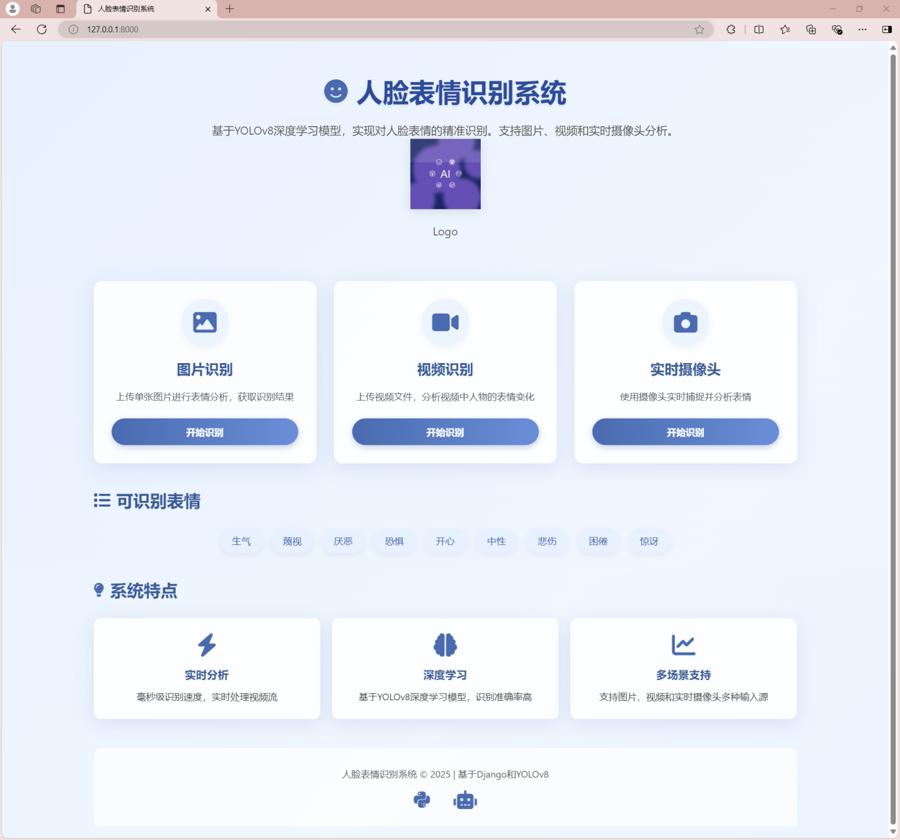
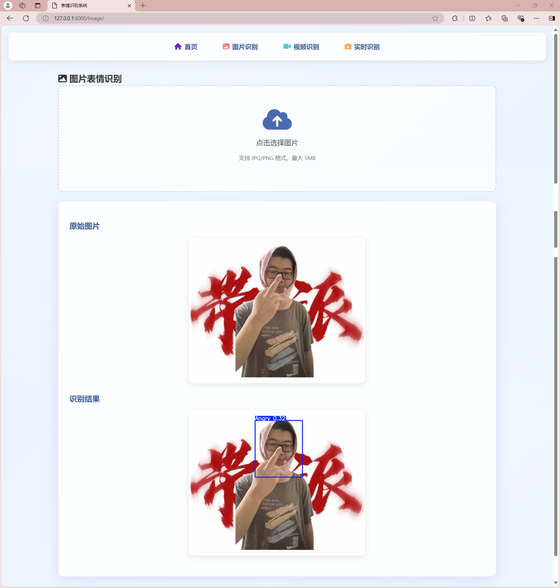
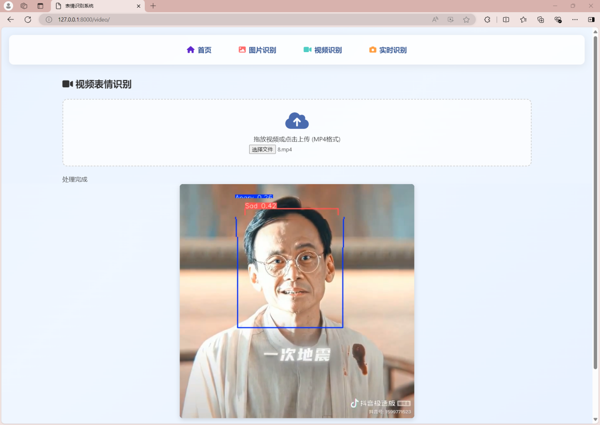
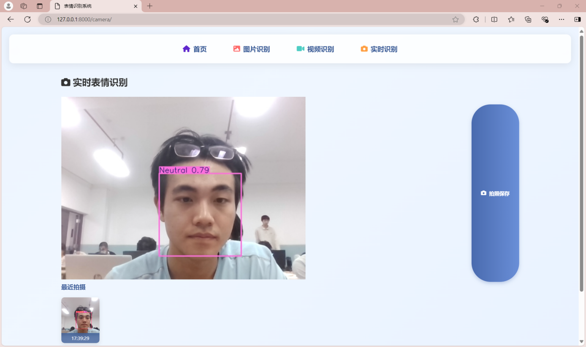

# 人脸表情识别系统

基于 **Django + YOLOv8** 的九种人脸表情识别系统，支持图片上传识别、视频逐帧分析和实时摄像头检测。


> 项目原名《基于 Django 与 YOLOv8m 的人脸表情识别系统》。仓库内置的 `weights/best.pt` 为 **YOLOv8n 规模**（约 3M 参数、6MB），便于克隆后直接运行；如需复现文档中的 YOLOv8m 方案，可将 `training/yolo/train.py` 中的 `yolov8n.pt` 换成 `yolov8m.pt` 重新训练。

## 功能特性

| 功能 | 说明 |
| --- | --- |
| 图片识别 | 上传 JPG/PNG 图片，返回带表情类别与置信度标注的结果图 |
| 视频识别 | 上传 MP4 视频，逐帧检测并合成标注视频（需要 FFmpeg） |
| 实时摄像头 | 浏览器调用摄像头，MJPEG 实时推流，支持抓拍保存 |
| 九种表情 | Angry / Contempt / Disgust / Fear / Happy / Neutral / Sad / Sleepy / Surprised |
| Web 界面 | Django Templates + 原生 JavaScript，无需额外前端构建 |

## 界面预览

| 首页 | 图片识别 |
| :---: | :---: |
|  |  |

| 视频识别 | 实时摄像头 |
| :---: | :---: |
|  |  |

## 技术栈

- **后端**：Python 3.10+、Django 5.1
- **检测模型**：YOLOv8（Ultralytics），九类表情目标检测
- **分类模型**：ResNet34、AlexNet、VGG16（PyTorch）
- **图像处理**：OpenCV、NumPy、Pillow
- **前端**：HTML5、CSS3、JavaScript
- **数据库**：SQLite（开发环境）

## 项目结构

```text
Facial-Recognize-System/
├── web/                          # Django Web 应用
│   ├── emotion_detection/        # 项目配置（settings / urls / wsgi）
│   ├── detection_app/            # 业务应用（视图、路由、模型加载）
│   ├── templates/                # 首页、图片、视频、摄像头页面
│   ├── static/                   # CSS / JS / Logo
│   ├── media/                    # 上传文件与识别结果（运行时生成）
│   ├── manage.py
│   └── requirements.txt
├── training/                     # 模型训练与评估
│   ├── dataset/                  # YOLO 格式数据集与 data.yaml
│   ├── yolo/                     # YOLOv8 训练 / 预测 / 评估 / 实时检测
│   ├── classifiers/              # ResNet34 / AlexNet / VGG16 分类模型
│   ├── augmentation/             # 表情数据增强
│   ├── tools/                    # 数据集裁剪、显存检查等工具
│   └── requirements.txt
├── weights/                      # 模型权重
│   └── best.pt                   # YOLOv8 检测权重（随仓库提供）
├── scripts/                      # 演示与工具脚本
├── docs/                         # 项目报告、答辩 PPT、界面截图
├── README.md
├── LICENSE
└── .gitignore
```

## 快速开始

### 1. 环境要求

- Python **3.10+**（已在 3.12 上测试）
- 视频识别需要安装 **FFmpeg**，并确保 `ffmpeg` 在 PATH 中
- 实时识别需要浏览器允许摄像头权限

### 2. 安装依赖

```bash
git clone https://github.com/Incredible-Jian/Facial-Recognize-System.git
cd Facial-Recognize-System

python -m venv .venv

# Windows
.venv\Scripts\activate
# macOS / Linux
source .venv/bin/activate

pip install -r web/requirements.txt
```

### 3. 启动 Web 服务

```bash
cd web
python manage.py migrate
python manage.py runserver
```

浏览器打开 <http://127.0.0.1:8000>。

> `web/db.sqlite3` 不纳入版本控制，首次运行执行 `migrate` 即可自动生成。

### 4. 模型权重

| 权重 | 大小 | 用途 | 获取方式 |
| --- | ---: | --- | --- |
| `weights/best.pt` | 6 MB | YOLOv8 检测，Web 端使用 | 已包含在仓库中 |
| `weights/resNet34.pth` | 82 MB | ResNet34 旧版 5 分类权重（不兼容九类，建议重训） | 见 [Releases](https://github.com/Incredible-Jian/Facial-Recognize-System/releases) |
| `weights/AlexNet_9classes.pth` | 56 MB | AlexNet 表情分类 | 见 [Releases](https://github.com/Incredible-Jian/Facial-Recognize-System/releases) |
| `weights/vgg16Net.pth` | — | VGG16 表情分类 | 运行训练脚本自行生成 |

下载后把 `.pth` 文件放到 `weights/` 目录即可。

## 模型训练与评估

```bash
pip install -r training/requirements.txt
```

### 数据集

`training/dataset/` 使用标准 YOLO 格式，`data.yaml` 已改为相对路径，换电脑无需修改：

```text
dataset/
├── data.yaml
├── train/{images,labels}
├── valid/{images,labels}
└── test/{images,labels}
```

仓库内置每个划分 100 张的样例数据，用于验证流程；完整实验使用 RAF-DB 与自建扩充数据（文档记录约 12000 张）。替换为自己的数据时，保持上述目录结构即可。

### YOLOv8 检测模型

```bash
python training/yolo/train.py      # 训练
python training/yolo/eval.py       # 验证集评估
python training/yolo/predict.py    # 单张图片预测
python training/yolo/video.py      # 摄像头实时检测（按 q 退出）
```

### 分类模型

```bash
# ResNet34
python training/classifiers/resnet/train.py
python training/classifiers/resnet/predict.py
python training/classifiers/resnet/eval.py

# AlexNet
python training/classifiers/alexnet/train.py
python training/classifiers/alexnet/predict.py
python training/classifiers/alexnet/eval.py

# VGG16
python training/classifiers/vgg/train.py
python training/classifiers/vgg/predict.py
python training/classifiers/vgg/eval.py
```

训练脚本会自动解析仓库内的数据集路径，输出权重保存在对应模型目录；评估脚本会生成混淆矩阵、ROC 曲线、分类报告等图片与文本。

## 接口说明

| 方法 | 路径 | 说明 |
| --- | --- | --- |
| GET | `/` | 首页 |
| GET | `/image/` | 图片识别页面 |
| POST | `/process_image/` | 上传图片并返回标注结果（`multipart/form-data`，字段名 `image`） |
| GET | `/video/` | 视频识别页面 |
| POST | `/process_video/` | 上传视频并返回标注视频（字段名 `video`） |
| GET | `/camera/` | 实时识别页面 |
| GET | `/video_feed/` | MJPEG 视频流 |
| POST | `/capture/` | 抓拍当前画面 |
| POST | `/stop_camera/` | 停止摄像头 |
| GET | `/admin/` | Django 管理后台 |

## 实验指标

以下数据来自项目文档，实际结果请以本地评估为准：

| 指标 | 报告值 |
| --- | --- |
| 九类表情分类准确率（RAF-DB 测试集） | 82.1% |
| 人脸检测 mAP@0.5（WIDER Face 验证集） | 98.7% |
| Happy 类别 Precision / Recall | 0.856 / 0.847 |
| 图片识别响应时间 | ≤ 2 秒 |
| 视频逐帧识别帧率 | ≥ 15 FPS |

## 项目文档

- [docs/](docs/) 目录包含：
  - 《基于 Django 与 YOLOv8m 的人脸表情识别系统项目管理实践》——范围、成本、进度、质量、风险管理
  - 《基于 Django 与 YOLOv8m 的人脸表情识别系统》——数据预处理、算法设计、系统实现
  - 项目答辩 PPT
  - 四个功能页面截图

## 常见问题

**Q：视频识别提示 `FFmpeg not found`？**
安装 FFmpeg 并加入 PATH；Windows 可用 `winget install ffmpeg` 或从官网下载后把 `bin` 目录加入环境变量。

**Q：摄像头页面一直加载？**
确认浏览器已允许摄像头权限，并关闭其他占用摄像头的程序（微信、腾讯会议等）。Windows 下代码使用 `cv2.CAP_DSHOW` 后端。

**Q：提示找不到 `weights/best.pt`？**
确认从仓库根目录克隆完整代码，`weights/best.pt` 应随仓库提供；也可以通过环境变量 `YOLO_MODEL_PATH` 指定其他权重路径。

**Q：视频处理很慢？**
视频逐帧推理默认在 CPU 上运行。有 NVIDIA GPU 时安装对应 CUDA 版 PyTorch 会明显加速。

## 团队

| 成员 | 分工 |
| --- | --- |
| 简川博 | 数据采集与预处理、YOLOv8 模型部署、Django 页面部署 |
| 王成龙 | YOLOv8m 与 ResNet 模型训练 |
| 李文超 | VGG16 与 AlexNet 模型训练 |
| 胡亦杰 | 图像处理与数据增强 |

## 许可证

本项目采用 [MIT License](LICENSE)。
